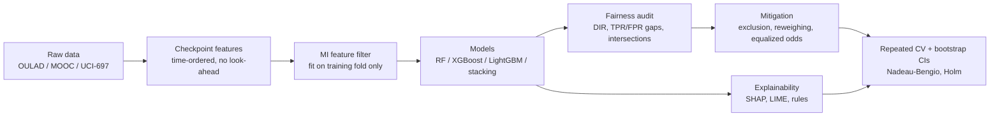

<div align="center">

# Bio-FairAlert

### Responsible early warning in higher education
**Multi-attribute fairness auditing · explainability validation · robust model comparison**

[](#quick-start)
[](LICENSE)
[](#datasets)
[](#reproduce-the-results)
[](#about)

[Quick start](#quick-start) · [Datasets](#datasets) · [Pipeline](#pipeline) · [Reproduce](#reproduce-the-results) · [UCI-697 validation](#external-validation-on-uci-697) · [Cite](#citation)

</div>

---

## About

Early-warning systems (EWS) that flag at-risk students are attractive to institutions, but they are not trustworthy until their **accuracy, fairness and explainability are audited rather than assumed**. This repository is the analysis code behind the Bio-FairAlert study. It is an *empirical audit*, not a new algorithm: it tests whether a model-comparison result, a fairness intervention and an explanation method each hold up under **resampling, multiple protected attributes and attribute intersections**.

> Every number, table and figure in the manuscript traces back to a script in this repository, and every script's output is archived in [`results/`](results/).

## What the audit examines

| | Question | Where |
|---|---|---|
| **RQ1** | How does predictive performance change across checkpoints and datasets? | `repeated_cv_significance.py` |
| **RQ2** | When does stacking beat the strongest single learner, and does it survive repeated-CV testing and equal-budget tuning? | `repeated_cv_significance.py`, `tuning_experiment.py` |
| **RQ3** | How does equalized-odds post-processing affect utility and fairness for the targeted attribute, untargeted attributes and their intersections? | `bootstrap_fairness.py`, `repeated_intersectional.py` |
| **RQ4** | Which signals drive predictions, and how stable and faithful are the explanations? | `explain_*.py`, `explanation_stability.py` |

## Headline findings

1. **Stacking is not a free win.** At a fixed 0.5 threshold a stacking ensemble underperformed its best base learner on both datasets at every checkpoint.
2. **Fixing one attribute can hurt another.** Equalized-odds post-processing targeted at one protected attribute improved that attribute's fairness while worsening gender's disparate-impact ratio.
3. **Excluding protected attributes is cheap.** It improved deprivation-band fairness at negligible accuracy cost, while gender disparity stayed essentially unchanged.
4. **Single-attribute audits miss disparities.** Every intersectional attribute pair showed worse disparities than any single-attribute audit revealed.
5. **Explanations are stable.** SHAP explanations were stable under resampling, agreed with permutation importance and passed a deletion test.

## Pipeline



**Leakage controls:** feature selection is confined to each split's training portion; post-processing calibration is fit on an independent held-out split; results are replicated across repeated splits.

## Datasets

All datasets are public and **not redistributed** here. Download them under `data/` (paths are set once in `src/config.py`, or override with the environment variables shown).

| Dataset | Role | Source | Files | Folder |
|---|---|---|---|---|
| **OULAD** | Main case study; has disability, deprivation band, gender | [Open University](https://analyse.kmi.open.ac.uk/open-dataset) | `studentInfo.csv`, `studentRegistration.csv`, `studentAssessment.csv`, `assessments.csv`, `courses.csv` | `data/oulad/` (`OULAD_DATA_DIR`) |
| **MOOC User Action** | Model-comparison generalizability; no demographics | [SNAP](https://snap.stanford.edu/data/act-mooc.html) | `mooc_actions.tsv`, `mooc_action_features.tsv`, `mooc_action_labels.tsv` | `data/mooc_raw/act-mooc/` (`MOOC_RAW_DIR`) |
| **UCI-697** | External validation incl. fairness; 4,424 students, CC BY 4.0 | [UCI, DOI 10.24432/C5MC89](https://doi.org/10.24432/C5MC89) | `data.csv` (auto-downloaded) | `data/uci697/` |

## Quick start

```bash
# 1. environment
python -m venv .venv && source .venv/bin/activate
pip install -r requirements.txt

# 2. put OULAD and MOOC files under data/ (see Datasets); UCI-697 downloads itself

# 3. run any script from inside src/
cd src
python repeated_cv_significance.py
python repeated_ablation.py 0        # ablation / intersectional scripts take a split index
```

Each script writes JSON into `results/`, already included in the repo, so you can inspect every result **without re-running anything**.

## External validation on UCI-697

A single self-contained script replicates the audit on a third dataset **that carries demographics**, so the fairness findings can be tested beyond OULAD.

```bash
cd src
python uci697_external_validation.py --quick --n_jobs 4      # smoke test, a few minutes
python uci697_external_validation.py --n_jobs 32             # full run -> ../results/uci697/
```

| Stage | What it produces |
|---|---|
| `main` | RandomForest, XGBoost, LightGBM and a stacking hybrid, each with and without the MI top-12 filter, at 3 checkpoints (enrolment, +1st semester, +2nd semester); 5x5 repeated CV, Nadeau-Bengio CIs, Holm-corrected paired tests |
| `ksweep` | MI vs ANOVA filter and k sensitivity |
| `fairness` | At-risk audit over gender, age (23+), scholarship, special needs, international status; exclusion, reweighing, equalized-odds post- and in-processing; side-effect matrix; intersectional audit; bootstrap CIs |
| `explain` | SHAP rank stability, SHAP vs permutation agreement, deletion test |

Outputs (CSV, LaTeX tables, `config.json`, `report.md`) go to `results/uci697/`. The data are small, so no GPU is needed; folds run in parallel on CPU cores.

## Project structure

```
Bio-FairAlert/
├── README.md
├── LICENSE
├── requirements.txt
├── src/
│   ├── config.py                       central path configuration
│   ├── features.py                     OULAD feature engineering
│   ├── mi_stacking.py                  OULAD feature selection + stacking
│   ├── mooc_features.py                MOOC feature engineering
│   ├── mooc_mi_stacking.py             MOOC feature selection + stacking
│   ├── repeated_cv_significance.py     Tables 1, 6 · Figures 3, 6
│   ├── bootstrap_fairness.py           Tables 2, 3, S1, S2
│   ├── fairness_panel_repeated.py      Table S3
│   ├── repeated_ablation.py            Table 4
│   ├── repeated_intersectional.py      Table 5
│   ├── explain_oulad.py / explain_mooc.py / explanation_stability.py
│   ├── uci697_external_validation.py   external validation on UCI-697
│   └── make_*.py                       figures
├── data/                               datasets go here (not included)
└── results/                            JSON / CSV / LaTeX output
```

## Reproduce the results

<details>
<summary><b>Script to result mapping</b> (click to expand)</summary>

#### Shared feature and model pipeline

| Script | Purpose |
|---|---|
| `features.py` | OULAD cohort construction and per-checkpoint feature engineering (behavioral, demographic, assessment). |
| `mi_stacking.py` | Mutual-information feature selection and the four-base-learner stacking ensemble (Logistic Regression, Random Forest, XGBoost, LightGBM) for OULAD. |
| `mooc_features.py`, `mooc_mi_stacking.py` | Equivalent feature engineering and stacking pipeline for the MOOC case study. |

#### Model comparison (Section 4.1, 4.4; Tables 1, 6; Figures 3, 6)

| Script | Purpose |
|---|---|
| `repeated_cv_significance.py` | Repeated 3x3-fold CV of stacking vs. best individual base learner, both datasets, with Nadeau-Bengio corrected paired t-test and Holm correction. |
| `analyze_repeated_cv.py` | Aggregates repeated-CV output into reported means, SDs, and corrected p-values. |
| `make_plots_repeated_cv.py` | Generates Figures 3 and 6. |
| `alt_meta_test.py` | Alternative (LightGBM) meta-learner robustness check (Section 4.1). |
| `tuning_experiment.py` | Equal-budget hyperparameter tuning check at representative checkpoints (Section 4.1, 4.4). |
| `baseline_experiment.py` | Majority-class and Explainable Boosting Machine reference baselines. |

#### Fairness calibration (Section 4.2; Tables 2, 3, S1, S2)

| Script | Purpose |
|---|---|
| `fairness_calibration.py`, `fairness_calibration_imdband.py` | Original illustrative single-split disability-targeted and imd_band-targeted equalized-odds calibration (the single-split numbers quoted for comparison). |
| `bootstrap_fairness.py` | Repeated 10-split version of both calibration runs; produces the mean and SD figures reported in Tables 2, 3, S1, S2. |
| `fairness_missing_sensitivity.py` | Sensitivity check excluding students with missing imd_band data. |
| `make_plots_bootstrap.py` | Generates Figure 4. |

#### Broader fairness panel (Table S3)

| Script | Purpose |
|---|---|
| `fairness_panel_repeated.py` | TPR/FPR gap, equalized-odds difference, demographic-parity difference, and per-group expected calibration error, across 5 repeated splits, before and after calibration. |

#### Protected-attribute ablation (Table 4)

| Script | Purpose |
|---|---|
| `ablation_experiment.py` | Original single-split ablation, superseded below and kept for the single-split number quoted in the text. |
| `repeated_ablation.py` | 10-repeated-split ablation that produces Table 4. |

#### Intersectional fairness (Table 5)

| Script | Purpose |
|---|---|
| `intersectional_fairness.py` | Original single-split intersectional analysis, superseded below. |
| `repeated_intersectional.py` | 5-repeated-split intersectional analysis that produces Table 5. |

#### Explainability (Section 4.3, 4.5; Figures 5, 7)

| Script | Purpose |
|---|---|
| `explain_oulad.py`, `explain_mooc.py` | SHAP, LIME, and rule-based explanations for both case studies. |
| `explanation_stability.py` | Perturbation-stability, deletion-test, permutation-importance, and cross-split explanation-overlap tests (Section 4.3). |

#### External validation on a third dataset (UCI-697)

| Script | Purpose |
|---|---|
| `uci697_external_validation.py` | Single self-contained script, four stages (`--stages main,ksweep,fairness,explain`). `main`: RandomForest, XGBoost, LightGBM and a stacking hybrid of the three, each with and without the MI top-12 filter, at three checkpoints (C0 enrolment, C1 +1st semester, C2 +2nd semester), 5x5 repeated CV with Nadeau-Bengio corrected CIs and Holm-corrected paired tests. `ksweep`: MI vs ANOVA filter and k sensitivity. `fairness`: at-risk (Dropout) audit over gender, age (23+), scholarship, special needs and international status, with exclusion of protected attributes, reweighing, equalized-odds post-processing and in-processing, a gender x scholarship joint target, the cross-attribute side-effect matrix, an intersectional audit, and student-level bootstrap CIs. `explain`: SHAP rank stability, SHAP vs permutation agreement, deletion test. |

```bash
cd src
python uci697_external_validation.py --quick --n_jobs 4      # smoke test, a few minutes
python uci697_external_validation.py --n_jobs 32             # full run -> results/uci697/
```

Output (CSV, LaTeX tables, `config.json`, `report.md`) is written to `results/uci697/`. The data are downloaded to `data/uci697/` on first run (git-ignored). The data are small, so a GPU is not needed; the script parallelises over CV folds on CPU cores.

#### Figures

| Script | Purpose |
|---|---|
| `make_arch_figures_v2.py` | Current figures: system architecture and intervention workflow (Figures 1, 2). |
| `make_arch_figures.py` | Earlier version of the same two figures, kept for the record and superseded by `make_arch_figures_v2.py`. |
| `make_plots.py` | Shared plotting helpers used by the scripts above. |

</details>

## Results archive

`results/` holds the raw and aggregated output of every script, so any reported number can be traced to a specific file without re-running the pipeline.

> [!NOTE]
> `mi_stacking_partial_BUGGY.json` is an intentionally retained early run of the stacking pipeline (a since-fixed meta-learner miscalibration bug), kept to document the debugging process referenced in Section 4.1. It is not used for any reported result.

## Citation

The manuscript is in revision; a full citation will be added on publication. Please also cite the datasets:

```bibtex
@article{kuzilek2017oulad,
  title   = {Open University Learning Analytics dataset},
  author  = {Kuzilek, Jakub and Hlosta, Martin and Zdrahal, Zdenek},
  journal = {Scientific Data}, volume = {4}, pages = {170171}, year = {2017}
}

@inproceedings{kumar2019jodie,
  title     = {Predicting Dynamic Embedding Trajectory in Temporal Interaction Networks},
  author    = {Kumar, Srijan and Zhang, Xikun and Leskovec, Jure},
  booktitle = {KDD}, year = {2019}
}

@misc{realinho2021uci697,
  title        = {Predict Students' Dropout and Academic Success},
  author       = {Realinho, Valentim and Vieira Martins, M{\'o}nica and Machado, Jorge and Baptista, Lu{\'i}s},
  year         = {2021}, publisher = {UCI Machine Learning Repository},
  doi          = {10.24432/C5MC89}
}
```

## License

Released under the [MIT License](LICENSE). The datasets keep their own licenses (UCI-697: CC BY 4.0).
