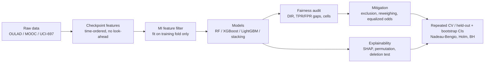

<div align="center">

# Bio-FairAlert

### Auditing fairness, explanations and model choice in student early-warning systems
**Intersectional cell-level audits · multiplicity-aware inference · held-out evaluation · three public datasets**

[](#quick-start)
[](LICENSE)
[](#datasets)
[](#results-archive)
[](#citation)

[Findings](#key-findings) · [Quick start](#quick-start) · [Datasets](#datasets) · [Reproduce](#reproduce-the-results) · [Limitations](#limitations) · [Cite](#citation)

</div>

---

## About

Early-warning systems (EWS) that flag students at risk of failure or dropout are only as trustworthy as the audit behind them. This repository is the analysis code and archived output of the Bio-FairAlert study, an **empirical audit, not a new algorithm**. A gradient-boosting pipeline (optional mutual-information filter, optional stacking, a mitigation layer and SHAP explanations) is evaluated with repeated cross-validation, corrected paired inference, student-level bootstrap intervals and Holm / Benjamini-Hochberg control over exploratory comparisons.

Three public datasets are used. **OULAD** (32,593 enrolments; disability, deprivation band, gender) and **UCI-697** (4,424 students; gender, age, scholarship, special needs, nationality) carry protected attributes and are audited for fairness. **MOOC** has no demographics and contributes model-comparison results only.

> Every number in the manuscript traces to a script here, and each script's output is archived in [`results/`](results/). The UCI-697 and OULAD held-out tables are generated by code (`make_tables.py`, `make_tables_oulad.py`), not typed by hand.

## Research questions

| | Question | Main scripts |
|---|---|---|
| **RQ1** | Do an MI filter and a stacked ensemble beat a strong single learner? | `repeated_cv_significance.py`, `tuning_experiment.py`, `uci697_external_validation.py` |
| **RQ2** | What do pre-, in- and post-processing mitigations cost and buy for the attribute they target, per fairness criterion? | `reanalysis_uci697.py`, `oulad_audit.py` |
| **RQ3** | What happens to non-targeted attributes and to intersections (cells)? | `reanalysis_uci697.py`, `oulad_audit.py`, `repeated_intersectional.py` |
| **RQ4** | Are SHAP explanations stable and faithful? | `explanation_stability.py`, `uci697_external_validation.py --stages explain` |

## Key findings

All intervals below are 95% student-level bootstrap or Nadeau-Bengio corrected intervals in the manuscript; see the paper and `results/` for the full tables.

1. **The largest detection gap is intersectional (UCI-697).** With enrolment-time information only, 27.9% of eventual dropouts among women holding a scholarship are detected, against 70.9% among men without one. With second-semester information the figures are 50.8% and 78.7%, while the marginal gender TPR gap is only 0.046. A marginal audit does not reveal this.
2. **Mitigation effects depend on the fairness criterion.** On UCI-697 reweighing narrows targeted error-rate gaps at almost no accuracy cost but moves the disparate-impact ratio (DIR) little at the latest checkpoint; threshold optimisation moves every criterion most, for roughly 3-5 macro-F1 points, and no targeted DIR reached 0.8.
3. **Side effects do not transfer between datasets.** Of 405 exploratory cross-attribute comparisons on UCI-697, 10 were significantly adverse and 69 favourable without adjustment (about 10 of each expected by chance); after Holm adjustment none was adverse and 40 favourable. The two adverse results surviving BH control are one contrast: age-targeted threshold optimisation widens the gender EO difference (+0.036 at C0, +0.028 at C2). On OULAD, gender DIR worsened in all 10 splits under disability- and IMD-targeted post-processing.
4. **Held-out OULAD evaluation changes the picture.** Training on 2013 presentations, tuning on 2014B and testing once on 2014J gave macro-F1 0.634 (day 25) and 0.664 (day 50), far below random-split figures. Gender is near parity at day 25 (DIR 0.994) but deprivation is not (IMD DIR 0.27-0.29, EO difference 0.36-0.39). IMD-targeted mitigation cut that EO difference by 0.19-0.29 for 0.008-0.033 macro-F1. Gender-targeted exponentiated gradient and reweighing did not help and at day 50 widened the gender EO difference. Of 168 side-effect comparisons per checkpoint, 1 (day 25) and 3 (day 50) adverse changes survived Holm adjustment.
5. **Common gender-targeted comparison.** Under the same repeated-CV protocol, gender-targeted post-processing improves gender error-rate gaps on both OULAD (day 75) and UCI-697, most for threshold optimisation (OULAD EO change -0.066 for 0.015 macro-F1). Magnitudes are not comparable across datasets; method ordering is.
6. **Stacking and the MI filter are not reliable gains.** A stack never significantly beat its best single learner at a fixed threshold, and was significantly worse on OULAD at every checkpoint; the MI filter lowered UCI-697 macro-F1 by 0.004 to 0.027.
7. **Explanations are stable.** Global SHAP rankings were stable under resampling and passed a median-replacement deletion test; they describe learned association, not causes.

## Limitations

- UCI-697 has no dates, so its checkpoints are retrospective information sets; a timing-sensitivity rerun (`results/uci697_notiming/`) shows the cell finding is not an artefact of two fields with undocumented recording time.
- The OULAD held-out evaluation uses a single test presentation (2014J), two early checkpoints and one tuning presentation; held-out and random-split numbers are not strictly paired because the checkpoints differ.
- Bootstrap intervals are conditional on the fitted models and do not reflect retraining variability; held-out fairness intervals use one seed.
- Side-effect comparisons are exploratory and not independent. Several cells are small (e.g. 89 scholarship-holding women who dropped out).
- No data exist on whether flagged students received or benefited from support, so no result shows that any mitigation is safe or beneficial.

## Pipeline



**Leakage controls:** feature selection is confined to each training portion; post-processing calibration and decision thresholds are fitted on data disjoint from the evaluation data; in the held-out protocol students seen in the test presentation are removed from training and validation, and nothing is tuned on the test presentation.

## Datasets

All datasets are public and **not redistributed** here. Download them under `data/` (paths are set in `src/config.py`, or via the environment variables shown).

| Dataset | Role | Source | Files | Folder |
|---|---|---|---|---|
| **OULAD** | Fairness audit; held-out presentation protocol | [Open University](https://analyse.kmi.open.ac.uk/open-dataset) | `studentInfo.csv`, `studentRegistration.csv`, `studentAssessment.csv`, `assessments.csv`, `courses.csv` | `data/oulad/` (`OULAD_DATA_DIR`) |
| **MOOC User Action** | Model comparison only; no demographics | [SNAP](https://snap.stanford.edu/data/act-mooc.html) | `mooc_actions.tsv`, `mooc_action_features.tsv`, `mooc_action_labels.tsv` | `data/mooc_raw/act-mooc/` (`MOOC_RAW_DIR`) |
| **UCI-697** | Fairness audit; 4,424 students, CC BY 4.0 | [UCI, DOI 10.24432/C5MC89](https://doi.org/10.24432/C5MC89) | `data.csv` (auto-downloaded) | `data/uci697/` |

## Quick start

```bash
python -m venv .venv && source .venv/bin/activate
pip install -r requirements.txt     # fairlearn and scikit-learn versions must be compatible (see note below)

cd src
python repeated_cv_significance.py                                   # OULAD / MOOC model comparison
python uci697_external_validation.py --quick --n_jobs 4              # UCI-697 smoke test
python uci697_external_validation.py --n_jobs 32                     # UCI-697 full run -> ../results/uci697/
python reanalysis_uci697.py                                          # criterion-specific, multiplicity-aware, cell-level reanalysis
python oulad_audit.py --mode heldout --cutoffs 25,50 --out ../results/oulad_heldout --n_jobs 8
python oulad_audit.py --mode cv --cutoffs 75 --repeats 5 --out ../results/oulad_cv_gender --cv_targets gender --n_jobs 8
python make_tables.py && python make_tables_oulad.py                 # LaTeX tables from the saved CSVs
```

Everything is archived in `results/`, so every result can be inspected **without re-running anything**.

> [!IMPORTANT]
> `ThresholdOptimizer` and `ExponentiatedGradient` come from `fairlearn`. A `fairlearn` release that is newer than your `scikit-learn` supports can break their import. `oulad_audit.py` raises on such errors instead of silently skipping the method; if you see one, install a matching pair (for example upgrade `scikit-learn`, or pin an older `fairlearn`) rather than ignoring it.

A one-command runner for a GPU server is provided: `bash run_oulad_h200.sh [all|heldout|cv|regen]` (only the bootstrap matrix products use the GPU; model fitting is CPU tree boosting).

## OULAD held-out protocol (`oulad_audit.py`)

| Item | Setting |
|---|---|
| Task | Binary at-risk = Fail or Withdrawn; LightGBM (200 trees) on the MI top-12 features |
| Split | Train 2013B + 2013J; tune decision threshold and threshold optimiser on 2014B; test once on 2014J |
| Leakage control | Students present in the test presentation removed from train/validation; presentation code not a feature |
| Checkpoints | Day 25 and day 50 (held-out); day 75 (repeated CV, gender-targeted only) |
| Audited groupings | Gender, disability, IMD band (11 groups), age band, gender x disability, gender x IMD<30% |
| Mitigations | Reweighing, exponentiated gradient (EO), threshold optimisation (EO), targeted at gender, disability, IMD band and gender x disability |
| Inference | Student-level multinomial bootstrap, B = 20,000, paired with the baseline; Holm and BH over the side-effect family (168 comparisons per checkpoint); performance over 5 retraining seeds |

Outputs: `*_fairness.csv` (every metric, interval and adjusted p-value), `*_cells.csv` (cell counts, TPR, FPR) and `*_seed_performance.csv`.

## Project structure

```
Bio-FairAlert/
├── README.md
├── LICENSE
├── requirements.txt
├── run_oulad_h200.sh                    one-command OULAD runner (held-out, CV, regeneration check)
├── src/
│   ├── config.py                        central path configuration
│   ├── features.py                      OULAD feature engineering
│   ├── mi_stacking.py / mooc_*.py       feature selection, stacking, MOOC pipeline
│   ├── repeated_cv_significance.py      model comparison with Nadeau-Bengio inference
│   ├── bootstrap_fairness.py / fairness_panel_repeated.py / repeated_ablation.py / repeated_intersectional.py
│   ├── explain_oulad.py / explain_mooc.py / explanation_stability.py
│   ├── uci697_external_validation.py    UCI-697 models, fairness, explanations
│   ├── reanalysis_uci697.py             criterion-specific, multiplicity-aware, cell-level reanalysis
│   ├── oulad_audit.py                   OULAD held-out presentation and gender-targeted CV audits
│   ├── make_tables.py / make_tables_oulad.py   LaTeX tables from saved CSVs
│   ├── compare_regen.py                 diff regenerated against archived JSON results
│   └── make_*.py                        figures
├── data/                                datasets go here (not included)
└── results/                             JSON / CSV / LaTeX output (uci697/, uci697_notiming/, oulad_heldout/, oulad_cv_gender/)
```

## Reproduce the results

<details>
<summary><b>Script to result mapping</b> (click to expand)</summary>

#### Shared feature and model pipeline

| Script | Purpose |
|---|---|
| `features.py` | OULAD cohort construction and per-checkpoint feature engineering (behavioral, demographic, assessment). |
| `mi_stacking.py` | Mutual-information feature selection and the four-base-learner stacking ensemble (Logistic Regression, Random Forest, XGBoost, LightGBM) for OULAD. |
| `mooc_features.py`, `mooc_mi_stacking.py` | Equivalent feature engineering and stacking pipeline for the MOOC case study. |

#### Model comparison

| Script | Purpose |
|---|---|
| `repeated_cv_significance.py` | Repeated 3x3-fold CV of stacking vs. best individual base learner, both datasets, with Nadeau-Bengio corrected paired t-test and Holm correction. |
| `analyze_repeated_cv.py` | Aggregates repeated-CV output into reported means, SDs, and corrected p-values. |
| `make_plots_repeated_cv.py` | Generates the repeated-CV figures. |
| `alt_meta_test.py` | Alternative (LightGBM) meta-learner robustness check . |
| `tuning_experiment.py` | Equal-budget hyperparameter tuning check at representative checkpoints . |
| `baseline_experiment.py` | Majority-class and Explainable Boosting Machine reference baselines. |

#### Fairness calibration

| Script | Purpose |
|---|---|
| `fairness_calibration.py`, `fairness_calibration_imdband.py` | Original illustrative single-split disability-targeted and imd_band-targeted equalized-odds calibration (the single-split numbers quoted for comparison). |
| `bootstrap_fairness.py` | Repeated 10-split version of both calibration runs; produces the mean and SD figures reported in Tables 2, 3, S1, S2. |
| `fairness_missing_sensitivity.py` | Sensitivity check excluding students with missing imd_band data. |
| `make_plots_bootstrap.py` | Generates the bootstrap-fairness figure. |

#### Broader fairness panel

| Script | Purpose |
|---|---|
| `fairness_panel_repeated.py` | TPR/FPR gap, equalized-odds difference, demographic-parity difference, and per-group expected calibration error, across 5 repeated splits, before and after calibration. |

#### Protected-attribute ablation

| Script | Purpose |
|---|---|
| `ablation_experiment.py` | Original single-split ablation, superseded below and kept for the single-split number quoted in the text. |
| `repeated_ablation.py` | 10-repeated-split ablation (the version used in the paper). |

#### Intersectional fairness

| Script | Purpose |
|---|---|
| `intersectional_fairness.py` | Original single-split intersectional analysis, superseded below. |
| `repeated_intersectional.py` | 5-repeated-split intersectional analysis (the version used in the paper). |

#### Explainability

| Script | Purpose |
|---|---|
| `explain_oulad.py`, `explain_mooc.py` | SHAP, LIME, and rule-based explanations for both case studies. |
| `explanation_stability.py` | Perturbation-stability, deletion-test, permutation-importance, and cross-split explanation-overlap tests . |

#### External validation on a third dataset (UCI-697)

| Script | Purpose |
|---|---|
| `uci697_external_validation.py` | Single self-contained script, four stages (`--stages main,ksweep,fairness,explain`). `main`: RandomForest, XGBoost, LightGBM and a stacking hybrid of the three, each with and without the MI top-12 filter, at three checkpoints (C0 enrolment, C1 +1st semester, C2 +2nd semester), 5x5 repeated CV with Nadeau-Bengio corrected CIs and Holm-corrected paired tests. `ksweep`: MI vs ANOVA filter and k sensitivity. `fairness`: at-risk (Dropout) audit over gender, age (23+), scholarship, special needs and international status, with exclusion of protected attributes, reweighing, equalized-odds post-processing and in-processing, a gender x scholarship joint target, the cross-attribute side-effect matrix, an intersectional audit, and student-level bootstrap CIs. `explain`: SHAP rank stability, SHAP vs permutation agreement, deletion test. |

```bash
cd src
python uci697_external_validation.py --quick --n_jobs 4      # smoke test, a few minutes
python uci697_external_validation.py --n_jobs 32             # full run -> results/uci697/
```

Output (CSV, LaTeX tables, `config.json`, `report.md`) is written to `results/uci697/`. The data are downloaded to `data/uci697/` on first run (git-ignored). The data are small, so a GPU is not needed; the script parallelises over CV folds on CPU cores.

#### Figures

| Script | Purpose |
|---|---|
| `make_arch_figures_v2.py` | Current figures: system architecture and intervention workflow. |
| `make_arch_figures.py` | Earlier version of the same two figures, kept for the record and superseded by `make_arch_figures_v2.py`. |
| `make_plots.py` | Shared plotting helpers used by the scripts above. |

</details>

## Results archive

`results/` holds the raw and aggregated output of every script, so any reported number can be traced to a specific file without re-running the pipeline.

> [!NOTE]
> `mi_stacking_partial_BUGGY.json` is an intentionally retained early run of the stacking pipeline (a since-fixed meta-learner miscalibration bug), kept to document the debugging process. It is not used for any reported result.

## Citation

The manuscript is in revision; a full citation will be added on publication. Please also cite the datasets:

```bibtex
@article{kuzilek2017oulad,
  title   = {Open University Learning Analytics dataset},
  author  = {Kuzilek, Jakub and Hlosta, Martin and Zdrahal, Zdenek},
  journal = {Scientific Data}, volume = {4}, pages = {170171}, year = {2017}
}

@inproceedings{kumar2019jodie,
  title     = {Predicting Dynamic Embedding Trajectory in Temporal Interaction Networks},
  author    = {Kumar, Srijan and Zhang, Xikun and Leskovec, Jure},
  booktitle = {KDD}, year = {2019}
}

@misc{realinho2021uci697,
  title        = {Predict Students' Dropout and Academic Success},
  author       = {Realinho, Valentim and Vieira Martins, M{\'o}nica and Machado, Jorge and Baptista, Lu{\'i}s},
  year         = {2021}, publisher = {UCI Machine Learning Repository},
  doi          = {10.24432/C5MC89}
}
```

## License

Released under the [MIT License](LICENSE). The datasets keep their own licenses (UCI-697: CC BY 4.0).
